<p align="center">
  
</p>

<h1 align="center">Cliptrove</h1>

<p align="center">
  <b>All your game clips in one place.</b><br>
  Browse them by game, watch them, mix their audio, trim them and save copies for Discord.<br>
  Works with SteelSeries GG, NVIDIA, AMD, Xbox Game Bar, OBS and more. Runs entirely on your own PC.
</p>

<p align="center">
  <a href="https://github.com/Orio-03/Cliptrove/releases/latest"><b>Download for Windows</b></a>
  ·
  <a href="https://orio-03.github.io/Cliptrove/">Website</a>
  ·
  <a href="#get-started">Get started</a>
  ·
  <a href="PRIVACY.md">Privacy</a>
  ·
  <a href="docs/HOW-IT-WORKS.md">How it works</a>
</p>

<p align="center">
  <a href="https://github.com/Orio-03/Cliptrove/releases/latest"></a>
  <a href="https://github.com/Orio-03/Cliptrove/actions/workflows/ci.yml"></a>
  
  <a href="LICENSE.md"></a>
</p>

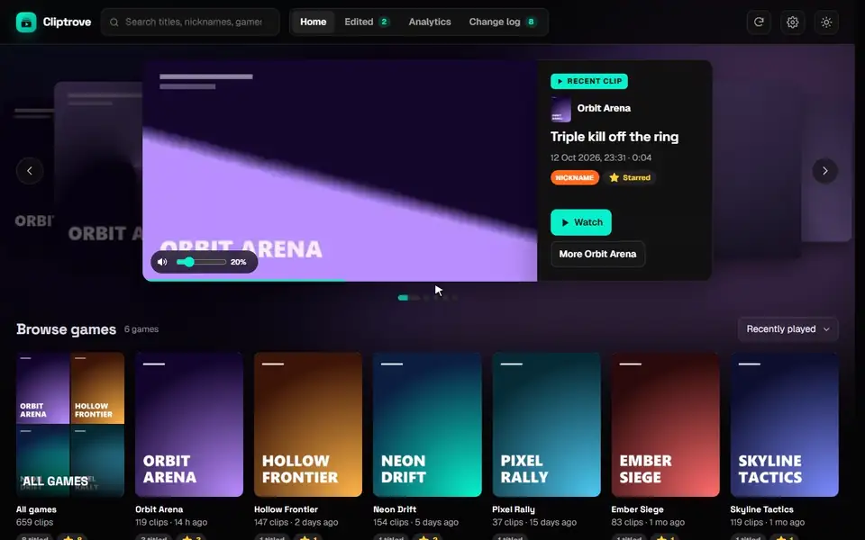

<sub>All screenshots and the demo use a library of made-up games.</sub>

## What it does

- **Every clip in one library.** Clips from different recorders are grouped by game, with cover art. Your newest clips play on the home page.
- **Hover to preview, click to watch.** The player has frame-by-frame stepping, looping, speeds and keyboard shortcuts.
- **Mix the audio.** If your recorder saves Game, Chat and Mic as separate tracks, set each one's volume, and see each track's waveform under the video. Cliptrove remembers your levels per clip.
- **Trim and save copies.** Save in original quality, or compressed under 18 MB so it fits on Discord. In the normal shape, or in portrait (9:16) for Reels, TikTok and Shorts, with fades if you like. Copy the saved file and paste it straight into Discord. Your originals are never changed.
- **Save stills.** Save the frame on screen as a picture, for thumbnails or memes.
- **Nicknames, stars and games.** Name your best clips, star them, and put clips under the right game.
- **Analytics.** See what you played and when, and which games you're likely to play next week.
- **Private by design.** No account, no uploads, no tracking. [Privacy](PRIVACY.md) has the details.

## Works with your recorder

| Recorder | What you do |
| --- | --- |
| **SteelSeries GG** | Nothing. It's found on its own, with GG's titles, stars, trims and Game/Chat/Mic levels. |
| **NVIDIA** (ShadowPlay / NVIDIA App) | Add the folder your clips are saved to. |
| **AMD** (Radeon ReLive / Adrenalin) | Add the folder your clips are saved to. Cliptrove usually suggests it for you. |
| **Xbox Game Bar** | Add your `Videos\Captures` folder. |
| **OBS Studio** | Add your recordings folder. Cliptrove suggests it from OBS's settings. |
| **Medal, or any other folder of videos** | Add the folder. Games are worked out from folder and file names. |

<a id="get-started"></a>

## Get started

### 1. Download

Open the [**latest release**](https://github.com/Orio-03/Cliptrove/releases/latest). Under **Assets**, click **`Cliptrove-…-windows.zip`** to download it.

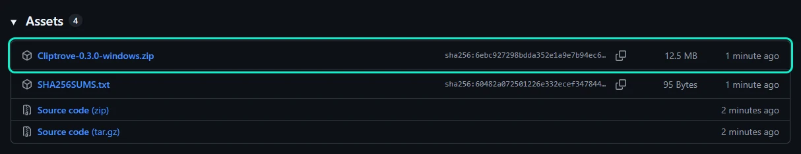

### 2. Unzip it and start Cliptrove

1. Right-click the zip and choose **Extract All…**. Pick a folder you'll keep, for example `Documents\Cliptrove`.
2. Open that folder and double-click **`Cliptrove.exe`**.

> [!NOTE]
> **Seeing "Windows protected your PC"?** Windows shows this for new apps that haven't paid for a code-signing certificate. Click **More info**, then **Run anyway**. You only need to do this once. Only download Cliptrove from this page's [Releases](https://github.com/Orio-03/Cliptrove/releases).

Your browser opens Cliptrove at **http://127.0.0.1:48650**. This address only works on your own PC.

### 3. Tell Cliptrove what you record with

The first time it starts, a short setup asks **which apps you record clips with**. Apps it finds on your PC are already ticked.

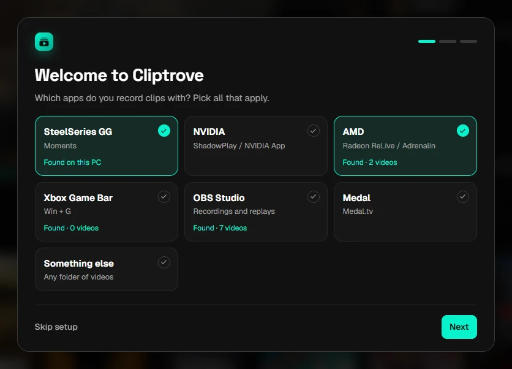

Next, it asks **where each app saves its clips**. Folders it found are filled in for you. Otherwise, click **Choose…** and pick the folder. SteelSeries GG needs no folder: Cliptrove reads its library directly.

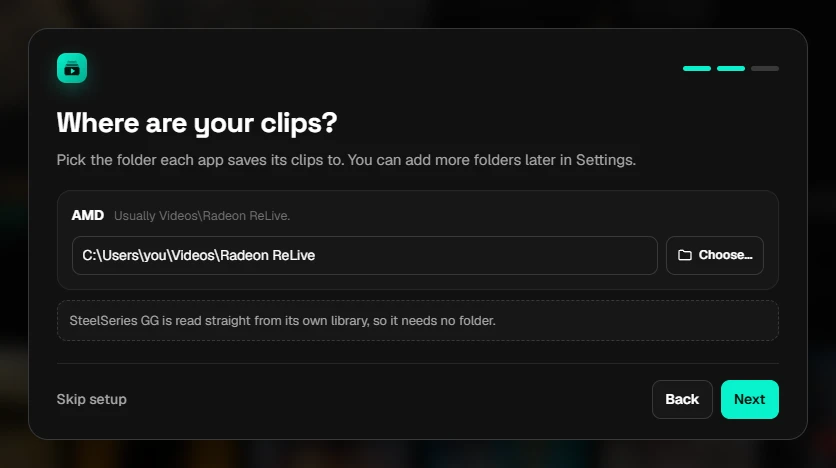

The last step offers **Start with Windows** and checks for ffmpeg. Setup only appears once. To add or remove folders later, use **Settings** (the gear icon at the top right).

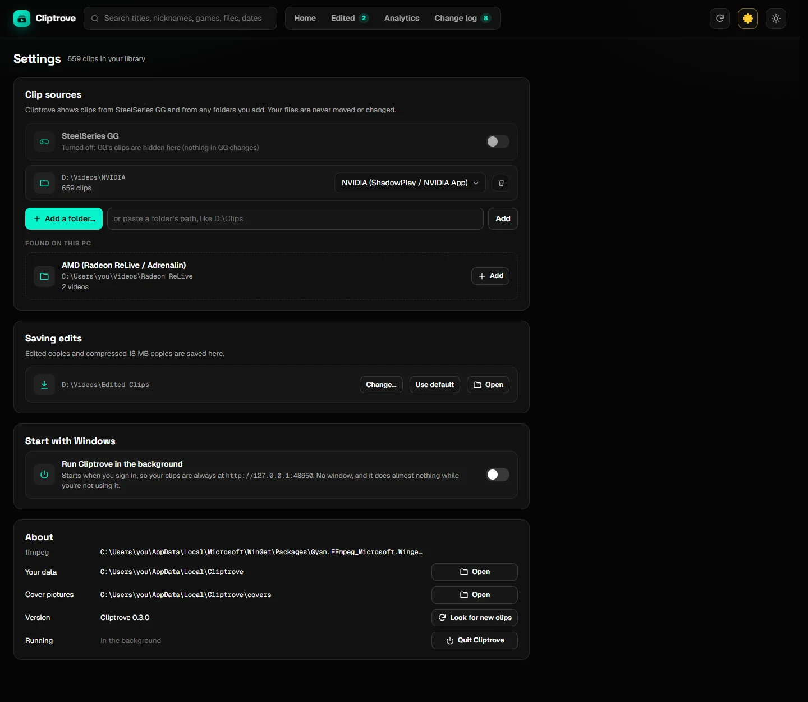

<details>
<summary>Not sure where your recorder saves clips?</summary>

| Recorder | Usual folder | Where it's set |
| --- | --- | --- |
| NVIDIA | `Videos\NVIDIA`, or a folder per game in `Videos` | The NVIDIA overlay (Alt+Z) > Settings |
| AMD | `Videos\Radeon ReLive` | AMD Software (Adrenalin) > Record & Stream settings |
| Xbox Game Bar | `Videos\Captures` | Windows Settings > Gaming > Captures |
| OBS | `Videos` | OBS > Settings > Output > Recording Path |
| Medal | Shown in Medal's settings | Medal > Settings |

The easiest way to check: right-click a clip in your recorder and choose "Show in folder", or "Open file location".

</details>

### 4. ffmpeg comes included

Thumbnails, separate Chat/Mic tracks, waveforms, playing .mkv files and saving edited copies use **ffmpeg**, a free video tool. The Windows app comes with it, in its `ffmpeg` folder, so there's nothing to install.

Running Cliptrove from the source code instead? Then install ffmpeg yourself: open **PowerShell** and run `winget install Gyan.FFmpeg`, then restart Cliptrove.

### 5. Start with Windows (optional)

Turn this on in Settings, so Cliptrove runs quietly in the background and **http://127.0.0.1:48650** always works. You can bookmark it.

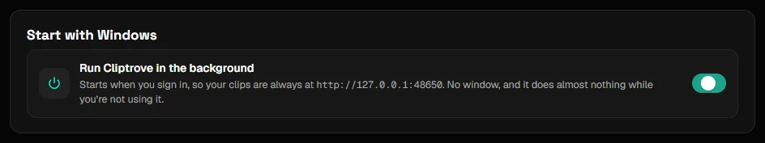

## Using Cliptrove

### Your library

The home page plays your newest clips, with a tile for every game below. Hover over a clip anywhere to preview it.

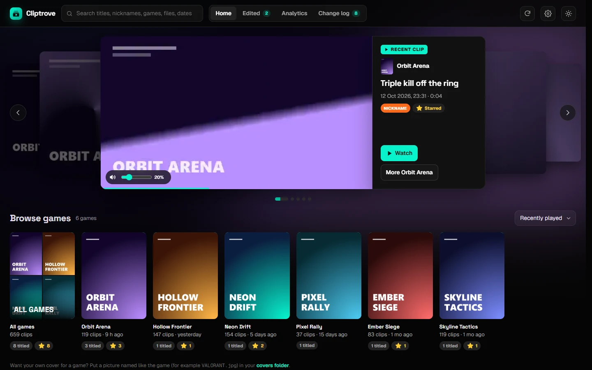

### Watch, mix and trim

Click any clip to open the player.

- **Audio:** each recorded track has its own volume slider. Cliptrove remembers your levels for that clip.
- **Waveforms:** under the video, each track (Game, Chat, Mic) has a lane showing its waveform, in its own color. A lane grows and shrinks with its slider, so you can see your mix. Click a lane to jump there. Press **W** to hide them.
- **Trim:** drag the green handles, or press **I** and **O**. Click **Keep this trim** so previews only play that part.
- **Save edited copy:** saves the part you picked, with your audio mix. Choose **Original quality** or **Compressed · 18 MB**, and:
  - **Normal · 16:9**, or **Portrait · 9:16** for Reels, TikTok and Shorts. For portrait, **Crop** keeps a 9:16 part of the picture (drag the frame on the video to choose which), and **Blurred background** shows the whole picture on a blurred copy of itself.
  - **Fade in and out**, for the picture and the sound.
  - When it's saved, **Copy** puts the file on the clipboard: press Ctrl+V in Discord to send it.
- **Save a still:** the camera button (or **C**) saves the frame on screen as a PNG, next to your edited copies.

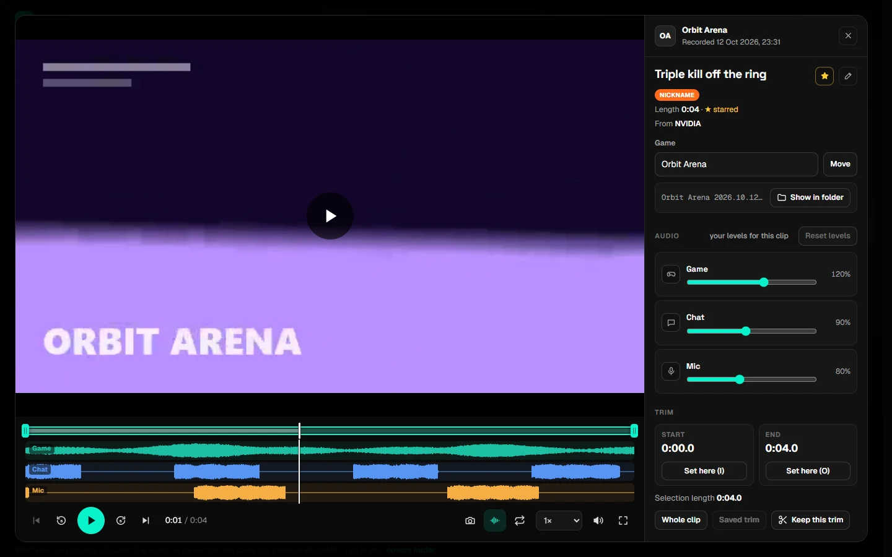

<details>
<summary>Keyboard shortcuts</summary>

| Keys | Does |
| --- | --- |
| Space / K | Play / pause |
| ← → | Back / forward 5 seconds (with Shift: 1 second) |
| J / L | Back / forward 10 seconds |
| , / . | One frame back / forward |
| I / O | Set the start / end of the selection |
| P / N | Previous / next clip |
| S | Star |
| R | Nickname |
| M / F | Mute / full screen |
| C | Save the frame on screen as a picture |
| W | Show / hide the waveforms |
| Esc | Close the player |

</details>

### Browse a game

Each game has its own page. You can filter it to titled or starred clips and sort it different ways.

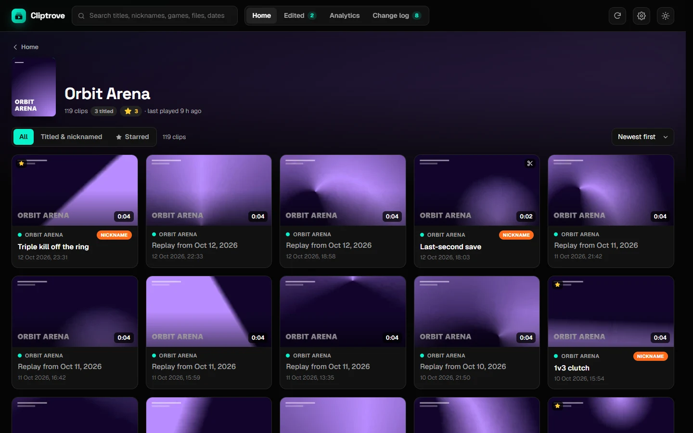

### Edited copies

Everything you've saved is in the **Edited** tab. Editing a copy again overwrites it, unless you untick **Overwrite**.

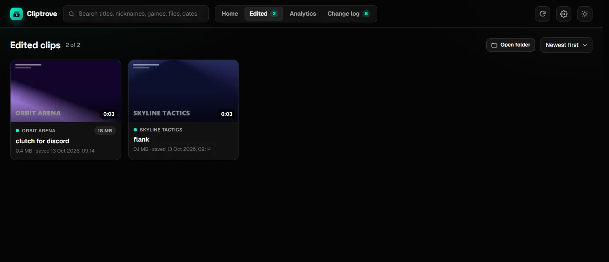

### Analytics

The **Analytics** tab shows:

- what you played week by week
- your top games
- when you usually play
- a calendar of the days you saved clips
- **Up next:** your chance of playing each game in the coming week

"Up next" comes from a small model trained on your own history, on your PC. Next to it, you can see how often it guessed right on your past weeks. [How it works](docs/HOW-IT-WORKS.md#analytics-and-up-next) explains the model.

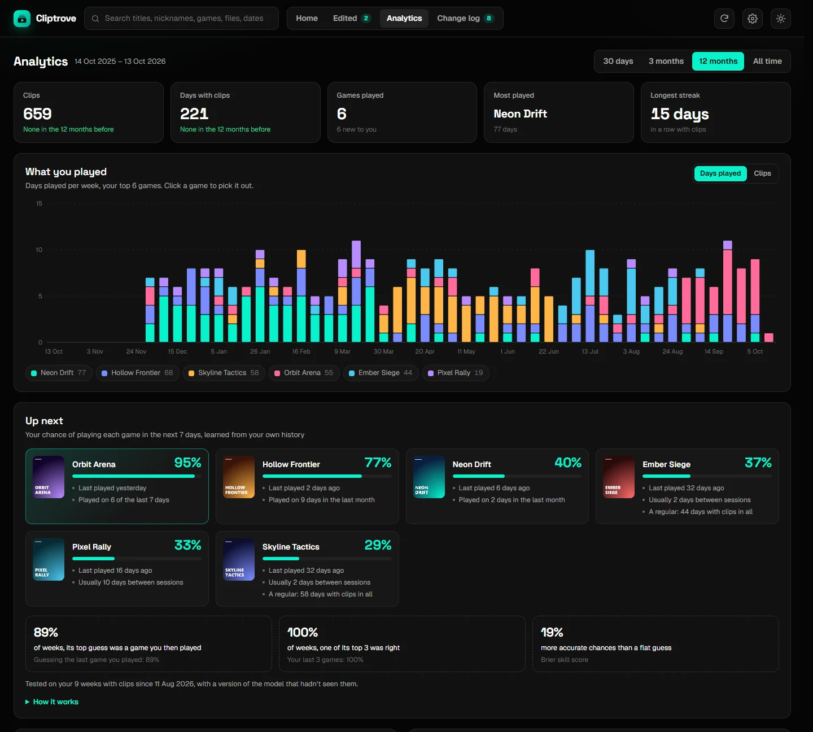

## Updating

1. In Cliptrove, go to Settings > About > **Quit Cliptrove**.
2. Download the new zip from [Releases](https://github.com/Orio-03/Cliptrove/releases) and unzip it **over** your old Cliptrove folder.
3. Start `Cliptrove.exe`.

Your settings, nicknames and other data are kept separately, so nothing is lost. If you put the new version in a **different** folder and use "Start with Windows", turn that switch off and on once.

## Uninstalling

Turn off **Start with Windows**, quit Cliptrove, and delete its folder. To also remove your settings and nicknames, delete `%LOCALAPPDATA%\Cliptrove`. Your clips are never touched. [Privacy](PRIVACY.md#removing-everything) has the details.

## Questions

Have a question or an idea? Ask in [**Discussions**](https://github.com/Orio-03/Cliptrove/discussions). Found a bug? [Report it](https://github.com/Orio-03/Cliptrove/issues/new/choose).

<details>
<summary><b>Some clips are under the wrong game, or under "Unsorted"</b></summary>

Recorders like OBS don't put the game in the file name. Open the clip and type the right game under **Game**. If it's a recorder Cliptrove should understand better, please [open an issue](https://github.com/Orio-03/Cliptrove/issues) with a few example file names, with anything personal removed.

</details>

<details>
<summary><b>No thumbnails, or Chat and Mic are greyed out</b></summary>

The Windows app comes with ffmpeg, which these need. If you run Cliptrove from the source code, install ffmpeg, see [step 4](#4-ffmpeg-comes-included). Chat and Mic only appear if your recorder saved them as separate tracks.

</details>

<details>
<summary><b>A clip won't play</b></summary>

Use Chrome or Edge. Firefox can't play clips recorded in HEVC (H.265).

</details>

<details>
<summary><b>Can anyone else see my clips?</b></summary>

No. Cliptrove only listens on your own PC. Other devices and websites can't reach it. See [Privacy](PRIVACY.md).

</details>

<details>
<summary><b>Does it change or move my files?</b></summary>

No. It only reads your clips. New files are only written when you save an edited copy, into the "Edited Clips" folder.

</details>

<details>
<summary><b>Is it free?</b></summary>

Yes, for personal and other noncommercial use. See [License](#license).

</details>

## For developers

Cliptrove is plain Python (standard library only) plus HTML, CSS and JavaScript. To run it from the source code, with [Python](https://www.python.org/downloads/) 3.10 or newer:

```
git clone https://github.com/Orio-03/Cliptrove.git
cd Cliptrove
python -m cliptrove
```

[How it works](docs/HOW-IT-WORKS.md) walks through the code. [Contributing](CONTRIBUTING.md) explains how to help, and [Security](SECURITY.md) how to report a problem privately.

## License

Cliptrove is © 2026 Ayman Kandouli and is available under the [PolyForm Noncommercial License 1.0.0](LICENSE.md).

- **Free** to use, share and change for personal and other noncommercial purposes, as long as you keep the license notice.
- **Not allowed** without permission: selling it, or using it in a commercial product or service. To ask about commercial use, [open an issue](https://github.com/Orio-03/Cliptrove/issues).

Cliptrove isn't affiliated with SteelSeries, NVIDIA, AMD, Microsoft, OBS, Medal or Valve. [Third-party notices](THIRD-PARTY-NOTICES.md) has the details.
