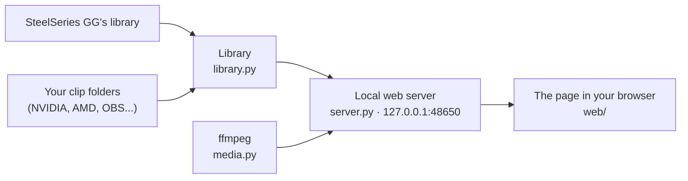

# How Cliptrove works

Cliptrove is a small Python program that runs a web server on your own PC and shows your clip library in your browser. It uses only Python's standard library. Optionally, it uses [ffmpeg](https://ffmpeg.org) for anything that needs to read or write video.



## Clip sources

Every source turns its clips into the same shape, so the rest of Cliptrove doesn't care which recorder made a clip.

### SteelSeries GG (`sources/gg.py`)

GG keeps its clip library in a SQLite database. Cliptrove copies the database to a temporary folder and reads:

- each clip's title, game, recording time, length and file
- GG's trim, star and Game/Chat/Mic levels

The database format isn't documented. If a GG update changes it, GG clips stop showing up until Cliptrove is updated; nothing else is affected.

### Folders (`sources/folder.py`, `names.py`)

Cliptrove looks through each folder you add, up to 4 levels deep. It skips the recorders' working folders (like AMD's `replay_cache`) and your "Edited Clips" folder.

For each video, it works out the game and the recording time from the file name:

| Recorder | Example file name |
| --- | --- |
| SteelSeries GG | `Counter-Strike-2__2024-06-16__23-06-36.mp4` |
| NVIDIA | `Counter-strike 2 2024.06.16 - 23.06.36.02.DVR.mp4` |
| AMD | `WARDOGS_replay_2026.09.12-17.41.mp4` |
| Xbox Game Bar | `Halo Infinite 2026-01-31 18-04-12.mp4`, or in your PC's own date format |
| OBS | `2024-06-16 23-06-36.mkv` |

- **Game:** if the name doesn't include one, the nearest folder named after a game is used (e.g. `Radeon ReLive\WARDOGS\`). If there isn't one either, the clip goes to **Unsorted**, where you can pick its game.
- **Ambiguous dates:** Xbox Game Bar writes the date in the PC's own format, so a date like `05_03_2025` could mean March or May. Cliptrove picks the reading closest to the file's own time.
- **Reading each file once:** the length and audio tracks come from `ffprobe`, once per file, and are cached in `index.json`. New files are read in the background, newest first.
- **Renamed files:** a renamed or moved file is recognized by its size and time, so its nickname, star and so on follow it.

### Putting it together (`library.py`)

The library merges the sources:

- **Duplicates:** a file GG already knows about isn't listed twice.
- **Game names:** a game gets one spelling across sources. GG's spelling wins, then Steam's (so `Counter-strike 2` from NVIDIA joins GG's `Counter-Strike 2`).
- **What you add:** your nicknames, stars, trims, audio levels and games are kept in `library.json`, keyed by clip.
- **New clips:** while the page is open, the library checks for new clips every 30 seconds.

## Video and audio (`media.py`)

Everything that touches video uses ffmpeg:

- **Thumbnails** for clips from folders, from a quarter of the way in.
- **Extra audio tracks** (Chat, Mic...) are copied out of the clip once. The page plays them alongside the video, in sync, each with its own volume.
- **.mkv, .flv and .ts clips** are repackaged as .mp4, which browsers can play. This copies the video without re-encoding it.
- **Saving edited copies:**
  - Every track is mixed at the volumes you picked.
  - Optionally, the loudness is evened out. Otherwise a limiter holds the loudest moments just under the maximum, so a loud game and a loud mic at the same moment don't add up to crackling.
  - The video is copied as it is, or re-encoded with your graphics card's encoder for exact cuts.
  - Compressed copies are re-encoded to land under 18 MB.

## The local server (`server.py`)

`server.py` serves the page and its data, the videos (with HTTP range requests, so you can seek), and a small JSON API.

It only listens on `127.0.0.1`. Every request must carry a random token that's new each time Cliptrove starts, and a `Host` header for this PC. That stops other websites in your browser from using it, including through DNS-rebinding tricks.

## The page (`web/`)

`index.html`, `app.css` and `app.js` are plain HTML, CSS and JavaScript, with no framework and no build step.

- **Charts:** drawn as SVG by hand.
- **Animations:** use the browser's View Transitions, and are turned off if you've asked Windows for reduced motion.

## Analytics and "Up next"

(`analytics.py`, and the analytics section of `app.js`)

- **What counts as playing:** a day with at least one clip of a game counts as a day you played it. That's a stand-in for real play time.
- **The charts** are worked out in the page.

**Up next** is a small logistic regression, fitted with Newton's method on your own history:

- **Inputs:** for each game it looks at two things:
  - **momentum:** days you played it, with recent days counting more, fading over about two weeks
  - **days since you last played it**
- **Training:** for every game and every past day, it learns how those relate to whether you played the game again in the next 7 days.
- **Honest check:** it's retrained using only older days, then tested on your most recent weeks. The page shows how often its top guess was right, next to simply guessing the last game you played.
- **Kept simple on purpose:** versions with more inputs (days played in the last week or month, the usual gap between sessions, and so on) were compared on real history and did no better.

It can't predict a game you've never played.

## Code map

| File | What it does |
| --- | --- |
| `cliptrove/app.py` | Starting up: command-line options, logging, "already running" |
| `cliptrove/server.py` | The local web server and its API |
| `cliptrove/library.py` | Merging sources, what you add to clips, edited copies |
| `cliptrove/sources/gg.py` | Reading SteelSeries GG's library |
| `cliptrove/sources/folder.py` | Reading clip folders |
| `cliptrove/names.py` | Game and date from file names |
| `cliptrove/media.py` | ffmpeg: probing, thumbnails, audio tracks, .mkv, saving copies |
| `cliptrove/covers.py` | Cover art from Steam, and your own cover pictures |
| `cliptrove/analytics.py` | The "Up next" model |
| `cliptrove/settings.py` | Settings, and finding recorders' folders on your PC |
| `cliptrove/autostart.py` | Start with Windows |
| `cliptrove/web/` | The page |
| `packaging/` | Building `Cliptrove.exe` |
| `tests/` | Unit tests |

## Running from the source code

You need [Python](https://www.python.org/downloads/) 3.10 or newer:

```
git clone https://github.com/Th30utcast/Cliptrove.git
cd Cliptrove
python -m cliptrove
```

You can also double-click `Cliptrove.bat`. Options:

```
--background    keep running when the tab is closed, and don't open the browser
--no-open       don't open the browser
--port N        use another port than 48650
--data-dir DIR  keep settings and caches somewhere else (handy for testing)
```

## Tests and automation

**What the tests cover:**

- **`tests/test_server.py`:** the local server.
  - who may use it: the token, and requests from other sites
  - bad requests: unknown clips, broken JSON, oversized requests, missing folders, invalid trims
  - the first-start setup, renames, new clips, damaged data files, and Quit
- **`tests/test_media.py`:** ffmpeg, on tiny generated videos (only when ffmpeg is installed).
  - probing, thumbnails, .mkv, extra tracks, saving copies
  - broken and vanished files
- **`tests/test_gg.py`:** SteelSeries GG reading, against a made-up GG database, including GG changing its format.
- **Smaller test files:**
  - `tests/test_names.py` and `tests/test_analytics.py`
  - `tests/test_settings.py` and `tests/test_util.py`
  - `tests/test_docs.py`: every link and picture in the docs and on the website exists
- **`tests/e2e/`:** a browser test that clicks through Cliptrove in headless Chrome, starting from the first-start setup.

`tests/support.py` keeps the test run safe on a real PC:
- every test uses temporary folders, never your real data
- nothing goes online
- SteelSeries GG and Start with Windows are never touched for real

**What runs automatically on GitHub:**

- **`.github/workflows/ci.yml`:** for every change, all of the tests, plus lint, coverage (a minimum of 75%), the browser test and a Windows build. It also runs weekly.
- **`.github/workflows/release.yml`:** publishes a release when the version goes up.
- **`.github/workflows/pages.yml`:** publishes the website.
- **`.github/workflows/dependabot-automerge.yml`:** merges Dependabot's minor updates once everything passes.

[Contributing](../CONTRIBUTING.md) shows how to run the checks yourself.

## Building the Windows app

```
python -m pip install -r packaging/requirements-build.txt
python packaging/build_windows.py
python packaging/smoke_test.py dist/Cliptrove/Cliptrove.exe
```

GitHub does this for every release. Pushing a tag like `v0.3.0` runs `.github/workflows/release.yml`, which:

1. tests the code
2. builds and smoke-tests `Cliptrove.exe`
3. publishes the zip and its SHA-256 checksum as a release
